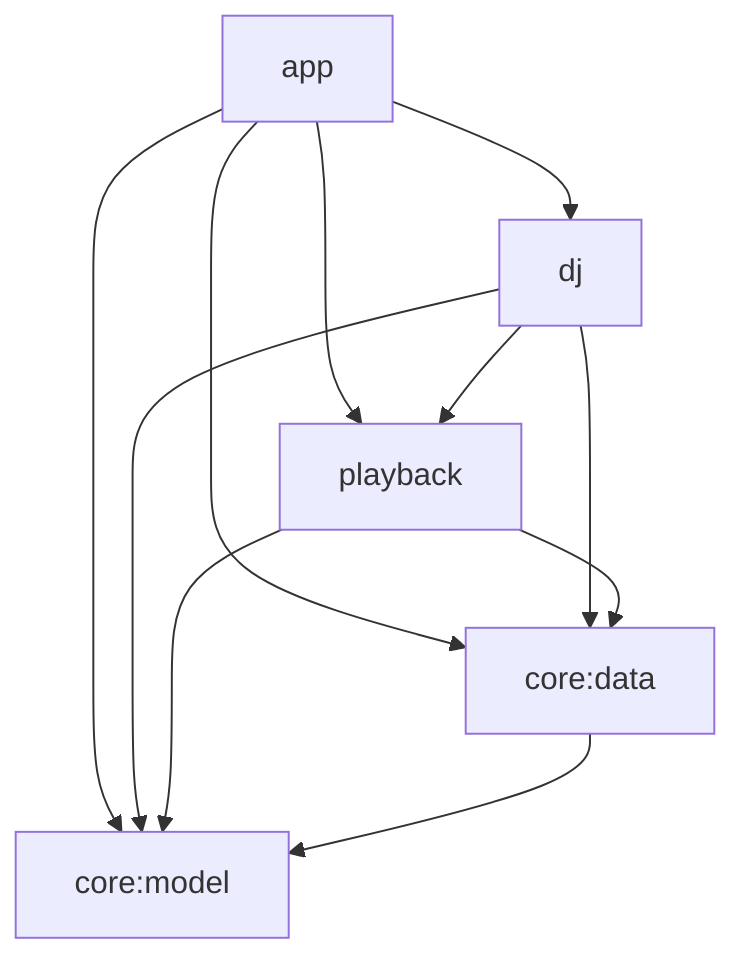

# Any Player Android — Architecture (integrated v2)

This document describes the built Kotlin multi-module system. The legacy behavior
specifications informed the rewrite; wire formats, persisted data and Android entry
points remain compatible. Sections 1–11 describe the implementation. Section 12
preserves the design-review amendments as a review record, not a second API reference;
its accepted decisions are incorporated below. Code is authoritative for exact signatures.

## 1. Goals and non-goals

- Spotify Connect remote control and local Media3 streaming for Jellyfin/Plex share
  mixed queues, shuffle/repeat, STANDARD/UNION custom playlists, distinct playback and search.
- State/config import/export, sync snapshot/push/WebSocket, remote/on-device AI DJ,
  MediaSession, Android Auto browsing and notification controls remain supported.
- Existing installs upgrade in place: application id `com.anyplayer.android`, versionCode
  2, Room `any_player.db` v3 with migrations from v1/v2, encrypted preference files/keys,
  DJ files and `anyplayer://spotify-callback` are preserved.
- Disk/crypto/network stay off Main. Playback state is event-driven; position widgets
  extrapolate anchors. Spotify alone polls its remote device while holding a run.
- New product features, a richer Auto catalog tree and server protocol changes are not
  part of this rewrite.

## 2. Key decisions

| # | Decision | Result |
|---|---|---|
| D1 | Five Gradle modules | Pure JVM model logic with Android integration in separate modules |
| D2 | Kotlin provider clients and normalization replace Rust FFI | No Rust/NDK build or sibling checkout; DJ native runtimes are prebuilt dependencies |
| D3 | One app-owned queue for all source mixes | Shared shuffle/repeat/previous semantics |
| D4 | Backends play bounded runs of one backend kind | Native Exo/Spotify advance with app-owned order; upcoming runs reconcile as playback advances |
| D5 | Stable queue-entry `uid` | Duplicate track ids identify distinct occurrences |
| D6 | Queue content, cursor and anchored player state are separate | `contentVersion` changes only for entries/order; position does not republish whole state |
| D7 | `SessionPlayer : SimpleBasePlayer` projects engine state | Media3 owns media notifications and controller events |
| D8 | Room queue content/cursor; plain non-secret playback settings | No recurring encrypted whole-queue writes |
| D9 | Lazy IO secure-store loading with in-memory flows | Existing encrypted files remain compatible |
| D10 | Normalized Room provider/union caches | Legacy blob rows import once; legacy tables remain for compatibility |
| D11 | Pure DJ reducer plus event-driven coordinator | Breaks are first-class plan items with explicit delivery lifetimes |
| D12 | Navigation Compose and per-screen ViewModels | Immutable screen state, stable occurrence keys, off-main list transforms |
| D13 | Paused local restore | No audible Spotify takeover until Play; saved position accompanies first load |

## 3. Modules and dependency rules

### Module map

| Module / package root | Main classes and contracts |
|---|---|
| `:core:model` — `com.anyplayer.android.core.model` | `Track`, `Playlist`, `QueueState`, `QueueOps`, `Run`, `PendingBreak`, `BreakSchedule`, `Dedupe`, `VolumeNormalization`, `AppJson`; `planRun`/`reduce` pure functions |
| `:core:data` — `com.anyplayer.android.data` | `AppDatabase`, `CustomPlaylistDao`, `QueueDao`, `CatalogCacheDao`, `LegacyCacheImporter`; `SecureConnectionStore`, `SecurePrefs`; `DefaultAuthRepository`, `DefaultSpotifyTokenProvider`; `JellyfinClient`, `PlexClient`, `SpotifyClient`, `ProviderRegistry`; `RoomCatalogRepository`, `RoomPlaylistRepository`, `PlaylistImporter`, `LegacyStateTransfer`, `LegacyConfigFiles`; settings/store, `SyncEngine` and `AppStartup` contracts |
| `:playback` — `com.anyplayer.android.playback` | `PlaybackEngine`, `DefaultPlaybackEngine`, `PlaybackBackend`, `ExoBackend`, `SpotifyBackend`, `SpotifyPlayerApi`, `SpotifyDeviceResolver`, `AudioCache`, `RoomPlaybackPersistence`, `LegacyPlaybackStateMigrator`, `SessionPlayer`; `AnyPlayerMediaLibraryService` retains `com.anyplayer.android.feature.playback.service` |
| `:dj` — `com.anyplayer.android.dj` | `DjController`, `DefaultDjController`, `DjCoordinator`, `DjAudioFiles`, `PassageRepository`, `RemoteBreakGenerator`, `OnDeviceBreakGenerator`, `ScriptGenerator`, `VoiceSynthesizer`, `VoiceProcessor`, `ArtifactStore`, `DjDiagnostics` |
| `:app` — `com.anyplayer.android` | `AnyPlayerApplication`, `MainActivity`, `DefaultAppStartup`, `ProcessStartupGate`, `DefaultSyncEngine`, `SyncClient`, `SyncImports`, `AppModule`; `ShellViewModel` and screen ViewModels under `ui` |

`:core:model` is pure Kotlin/JVM with no Android imports. The other four modules use
Android. UI consumes repository/controller/engine contracts, never DAOs, OkHttp or
ExoPlayer. Mutable flows stay private. Sync/startup **interfaces** live in
`core/data/.../sync/SyncContracts.kt`; implementations live in `app/.../sync` and
`app/.../startup` to compose data, playback and DJ without reverse dependencies.

Hilt singleton bindings supply repositories, stores and engines. `AppModule` provides
`@Named("spotifyClientId") String`, `@Named("appVersionCode") Int` and
`@Named("appVersionName") String` from BuildConfig, plus the legacy-cache startup adapter.
`DefaultAppStartup` resolves the singleton `DjController` after the startup gate;
constructing its `DjCoordinator` starts scheduling even before the DJ screen is opened.

## 4. Domain model (`:core:model`)

Serializable domain models retain legacy JSON names, lowercase source/repeat/state
serial names and STANDARD/UNION playlist semantics. `PlaybackStatus` remains a legacy
wire/transfer shape, not the live UI state. `AppJson` ignores unknown keys, omits explicit
nulls and leaves defaults unencoded; transfer integrity depends on that encoding.

### 4.1 Queue model

`QueueEntry(uid: Long, track: Track)` gives each occurrence a unique identity.
`QueueState` contains insertion-order `entries`, play-order `order` (entry indices),
play-order `cursor` (-1 when nothing is current), shuffle/repeat flags, `playNextOffset`,
`contentVersion` and `nextUid`. Accessors include `current`, `entryAt`, `upcoming`,
`history` and `orderPosOfUid`.

`QueueOps` is pure and accepts `Random` where needed:
- `replace(s, tracks, startIndex, random, randomStart=false)` preserves explicit starts.
  Random starts require a user play request at index 0 with shuffle on and >1 track;
  sync/restore never randomize.
- `playNext` inserts after current+offset in **both** insertion and play order, stacking
  calls in call order. Empty queues become one current entry.
- `advance`, `back` and `jumpToUid` move the cursor and reset the play-next offset.
  Only entries/order changes bump `contentVersion`; cursor and repeat changes do not.
- `setShuffle` preserves current identity (and history when enabling), while disabling
  restores insertion order. There is no `jumpToEntry` or queue `remove` API.
- Repeat ALL wraps manual/automatic next; ONE is delegated to backends. Engine previous
  seeks to 0 above 3000 ms, otherwise moves back; at the start it seeks to 0.

### 4.2 Run planning

`backendFor` recognizes valid normalized 22-character alphanumeric Spotify ids as
SPOTIFY. Other sources with http/https/file/content/android.resource URLs use EXO;
everything else is UNPLAYABLE.

`planRun(state, fromOrderPos, pendingBreak, maxItems=50): Run?` skips UNPLAYABLE entries
inside runs and returns null if no playable entry remains. Runs are EXO or SPOTIFY,
never UNPLAYABLE; they do not wrap and end at the next different playable backend.
`PlanItem.Song` carries entry/order position; `PlanItem.Break` carries break id/audio URI.
`PendingBreak(beforeUid, breakId, audioUri)` splices before the target in EXO runs;
Spotify stops before it and the engine uses a single-item EXO `breakRun` at the boundary.
The engine additionally enforces advance-only delivery (§8.2).

### 4.3 Other pure logic

- `Dedupe` uses normalized title/artist keys and the `dedup_spec.json` fixture.
- `VolumeNormalization` ports Rust output math with **Float** parity over 0..100 for
  every source; Spotify uses the 85 target and other sources the clamped attenuation.
- Playlist/Spotify id normalization and `trackIdsMatch` preserve provider identifiers.
- `BreakSchedule`/`reduce` implement §8.1 independently of Android.

## 5. Data layer (`:core:data`)

### 5.1 Room `any_player.db`

`AppDatabase` is version 3 with exported schemas in `core/data/schemas`.
`MIGRATION_1_2` retains the legacy distinct-playlist changes. `MIGRATION_2_3` only adds:
- `queue_entries(uid INTEGER PK, seq INTEGER, trackJson TEXT)`.
- `queue_meta(id=0 PK, orderUids TEXT, cursorUid INTEGER, contentVersion INTEGER)`;
  `orderUids` is comma-separated uid order. Cursor updates are content-version-qualified.
- `cached_playlists` keyed by `(source,id)`, with display/order/freshness fields.
- `cached_tracks(ownerKey,position,trackJson)` and
  `cached_track_owners(ownerKey,updatedAtMs,trackCount)`, using provider `p:<source>:<id>`
  and union `u:<id>` owners.

Legacy `custom_playlists`, `playlist_tracks`, `union_playlist_sources`,
`provider_playlist_preferences`, `column_preferences` and `app_cache_entries` remain.
Column preferences still round-trip through transfer. `LegacyCacheImporter` converts
legacy provider/union cache rows in the background, then deletes converted rows; migration
SQL never parses JSON. Catalog refresh removes vanished playlists' cached tracks in the
same transaction.

DAO transactions preserve count/timestamp/children consistency. Custom playlist upsert
uses INSERT OR IGNORE + UPDATE, not REPLACE; appends use `COALESCE(MAX(position)+1,0)`
to tolerate legacy gaps. Room opens lazily on its first off-main query; there is no
destructive migration fallback.

### 5.2 Stores and compatibility

| Contract / implementation | Backing and behavior |
|---|---|
| `SecurePrefs` | Lazy IO EncryptedSharedPreferences, shared default MasterKey AES256_GCM; key AES256_SIV/value AES256_GCM |
| `ConnectionStore` / `SecureConnectionStore` | `provider_connections`, uppercase source keys, `StoredConnection` JSON; mutex-protected writes and in-memory connections |
| `SpotifyAuthSessionStore` | `spotify_auth_session`: state, codeVerifier, clientId, redirectUri |
| `SyncSettingsStore` | Encrypted `sync_preferences`: `sync_preferences_json`, `sync_client_id`; in-memory `preferences` flow |
| `DjSettingsStore` | Same encrypted file: selected voice/model ids, remote-generation flag (default true), voice level (default 1.0) |
| `PlayerSettingsStore` | Plain `player_settings`: shuffle/repeat/volume/position, normalization enabled/strict, DJ enabled/queue-display flags; no cursor |
| `LegacyPlaybackStateMigrator` (`:playback`) | Reads encrypted `playback_state`/`status` once, maps occurrence-aware legacy ordered queue and insertion-space cursor, commits Room and flags before removing legacy key |

Secure stores load on IO and expose in-memory flows plus `awaitLoaded`; an initial empty
connection snapshot is not proof of disconnection. New `jellyfinUserId` is resolved lazily
for legacy connections on the first provider call, then persisted; legacy refresh-token
data is not interpreted as a Jellyfin user id.

### 5.3 Networking and providers

The provider/data HTTP helpers use OkHttp asynchronous `Call.await` with cancellation.
`executeRetrying` closes rejected responses before suspending: retry 429 for any method,
5xx only for GET/HEAD, up to five retries, numeric Retry-After capped at 60 s or exponential
0.5 s backoff capped at 10 s. `DefaultSpotifyTokenProvider` single-flights refresh and is
used by catalog/search/player calls; 401 gets one forced refresh/retry.

`ProviderClient` exposes source, validate, playlists, playlistTracks and typed search.
`ProviderRegistry` maps sources to `JellyfinClient`, `PlexClient`, `SpotifyClient`:
- Jellyfin uses legacy Emby token/authorization headers, resolves `/Users` when needed
  and generates `/Audio/{id}/universal` stream URLs; page size defaults to 300.
- Plex uses `X-Plex-Token`, JSON responses and the media Part stream path.
- Spotify uses Web API playlists/tracks/search and PKCE auth, not a native audio decoder.
  `DefaultAuthRepository.profiles` is UI-facing; `ConnectionStore.connections` holds
  persisted credentials. Restore is local for Jellyfin/Plex; Spotify refreshes when needed.
  Network failures do not erase credentials.

Data HTTP URL/token normalization lives in `data.net.Http.kt`; DJ currently keeps
equivalent internal `normalizeBase`/`normalizeToken` and `awaitDj` helpers in `DjHttp.kt`.
DJ uses the committed sync target/token; it does not use an uncommitted Settings draft.

### 5.4 Catalog and playlists

`RoomCatalogRepository` observes normalized playlist rows. Provider list refresh is
parallel with per-provider failures and retained offline cache. Tracks are cache-first,
with background revalidation after six hours; forced refresh replaces a whole owner
transactionally. `refreshAll` limits concurrent track fetches to four. Typed search
queries connected providers in Jellyfin/Plex/Spotify order and cancels with its caller;
results from providers that succeed are kept, and it throws (Search shows "Search failed")
only when every searched provider failed.

`RoomPlaylistRepository` implements `PlaylistRepository`; playback callers receive tracks
and hand them to `PlaybackEngine`. STANDARD and UNION CRUD, occurrence positions,
provider/custom distinct flags and union materialization preserve legacy semantics.
`PlaylistSourceEditor` adds incremental source editing without duplicating the repository
contract. Bounded parallel source fetches preserve source order; nested CUSTOM union
sources expand one level, identities dedupe by `(source,id)`, and cache/count/source edits
commit together. Observing UI data never initiates a provider fetch.

### 5.5 Sync contracts; implementation in `:app`

`SyncEngine` exposes state, start/connect/pull and conflict resolution. `DefaultSyncEngine`,
`SyncClient` and `SyncImports` compose playback and data using the legacy
`/v1/snapshot`, `/v1/state/{namespace}` and `/v1/ws` protocol.

- UI commits target/token on IME done/focus loss and tab/navigation departure; bounded
  writes finish even when that ViewModel is cleared. Only Connect changes the realtime
  account; automatic pushes retain the last start/Connect account.
- App-state pushes require a non-empty post-restore queue, ignore SYNC/RESTORE-origin changes
  and retain a 3.5 s post-apply echo guard. Discrete changes (including exact seek/pause
  position) coalesce with a 2 s minimum interval. There are **no periodic position pushes**.
- Startup pull applies playback only if local playback did not change during fetch.
  Applied snapshot versions always advance.
- Playlists and settings: while sync is confirmed and the domain is selected, local
  custom-playlist edits and normalization changes push their namespace (≥2 s coalescing)
  whenever the local export differs from that domain's merge base; applied remote data is
  never echoed back. Playlists merge three-way against their base on startup, realtime and
  non-forced pulls: only one side changed → that side wins silently; both changed → startup
  and manual pulls ask for overwrite confirmation, realtime pushes the local copy; no base yet
  → overwrite still requires confirmation. Force Pull and conflict resolution always overwrite.
- Cancelling the Connect conflict dialog stops realtime and automatic pushes until the next
  Connect or app start.
- App-state merge base: the queue-content signature (current track, queue, shuffle, repeat)
  last pushed to or applied from the target is persisted (`sync_app_state_base`, which also
  holds the playlists and settings bases). Startup
  and realtime pulls push local state instead of applying when the server still holds that
  base but local content differs (playback moved on while the server was unreachable or
  before sync started, e.g. Android Auto). The startup pull never replaces playback that is
  already playing. Content another client changed still applies; explicit pulls and conflict
  resolution always apply the server.
- WebSocket reconnect backs off 1–60 s with jitter and network availability gating.
  App-state events first fetch `/v1/state/app-state`, with snapshot fallback. Other
  namespace events never apply snapshot playback; playlist events use the three-way merge above.
- Imported normalization is persisted and applied; provider URL changes revalidate/refresh
  only the affected provider. Config summaries/errors reach Settings without rerunning startup.

### 5.6 State transfer and config import

`LegacyStateTransfer` and `LegacyConfigFiles` share `PlaylistImporter`, preserving
legacy formats, `_import_`/`_cfg_` deterministic remaps, canonical integrity encoding,
PBKDF2-HMAC-SHA256 (150,000 iterations, 16-byte salt), AES-256-GCM (12-byte nonce)
and standard Base64. Streams, large JSON and crypto run on IO.

Imports replace children only for imported destination playlists, preserving retained
local children. Connection imports merge without clearing tokens; dry runs write nothing;
REPLACE_ALL and MERGE_PREFER_IMPORT also apply the exported volume/shuffle/repeat through
the playback engine (MERGE_KEEP_LOCAL keeps local playback settings);
empty unions are allowed. Occurrence-aware deterministic ids preserve repeated tracks
and sources. Config export keeps its legacy Json defaults (`explicitNulls=true`,
`encodeDefaults=false`), distinct from AppJson's explicit-null omission.

### 5.7 Startup

`AnyPlayerApplication.onCreate` starts singleton `AppStartup`. `DefaultAppStartup` runs
on IO, awaits engine restore (including legacy queue migration), then restores provider
sessions. `ProcessStartupGate` waits for `ProcessLifecycleOwner` STARTED or actual playback
before constructing `DjController`, importing legacy caches, refreshing provider lists
and starting sync's startup pull/realtime. Thus media-only cold browsing restores locally
without starting DJ/catalog/sync network work. Restore runs every process start; failures
become `StartupStatus` warnings with Retry instead of a second startup path.

## 6. Playback (`:playback`)

### 6.1 Engine contract and reconciliation

`PlaybackEngine` exposes `queue`, `player`, `events`, `changes`, `positionMs` and
`awaitRestored`, plus queue/transport/volume/shuffle/repeat/normalization/pending-break
commands. Relevant mutations accept `ChangeOrigin.USER/SYNC/RESTORE`;
`EngineChange(origin,contentChanged)` carries origin on `changes`, not in `PlayerState`.

`PlayerState` holds status, `playRequested`, current uid, duration, position/time anchor,
volume, normalization, error, disabled reason and `activeBreak: ActiveBreak?`.
`DefaultPlaybackEngine` confines intents to Main.immediate and wakes one conflated
level-triggered reconcile loop. Desired run/play/seek/volume/repeat are compared with
applied backend state; in-flight backend commands are not cancelled. Backend switches
stop the old backend before loading the new one. Player-originated pauses become intent.

Every load/event has a generation `loadId`; `ItemKey.Song(uid)`/`Break(breakId)` identify
items independently of old indices. Stale events are ignored. Each ItemStarted reconciles
again, sliding EXO runs forward and retaining at most three history items.

Auth gating is inside the engine for UI/session/notification/sync alike; it exposes
`disabledReason` and still allows Next/Previous. Restore reads local stores and stays
paused without loading a backend; first Play carries the saved position. Queue content
writes debounce 500 ms by `contentVersion`, cursor writes are version-qualified Room
updates, flags/position use player settings (15 s playing checkpoint).

### 6.2 Backends

`PlaybackBackend` exposes events, `load(loadId,run,startIndex,positionMs,playWhenReady)`,
`updateUpcoming(loadId,run,currentKey)`, `seekToItem`, transport, volume, repeat-one,
stop and position/duration accessors. Events identify their load and item key, including
position discontinuities, player-originated play changes, run end and errors.

- `ExoBackend` lazily creates one Main-confined ExoPlayer with audio focus/noisy handling.
  Upcoming timeline edits retain the current item. Song ids use uid, breaks
  `dj-filler:<id>`. Playback/prefetch share `${SOURCE}:${trackId}` cache keys; next-track
  prefetch is bounded. `AudioCache` uses `cacheDir/audio_cache`, LRU 500 MiB and
  StandaloneDatabaseProvider; Jellyfin headers are request-origin-matched.
- `SpotifyBackend` serializes commands/polls with a mutex on
  `Default.limitedParallelism(1)`. It loads native URI runs with offset/position,
  adopts already-correct playing state within 3 s, disables remote shuffle and uses
  repeat track only for ONE. It never appends through Spotify's queue endpoint.
  Polling only runs while a started run is held (adaptive playing/near-end/paused rates).
  Raw progress detects stalls; recovery attempts are bounded. Re-anchors require drift
  >750 ms or state/track change. Relinked ids, settle windows and repeated unknown-id
  observations protect run-end detection.
- Spotify upcoming edits shorten a stop point or debounce a URI-run reload (300 ms).
  End timers pause before EXO/break boundaries to avoid Autoplay bleed. Foreground-only
  Spotify-app launch fallback and pre-resolution before Spotify boundaries live in
  `SpotifyDeviceResolver`/`BackendPreparer`. Normalized source volume is applied to each
  backend; Spotify volume writes debounce 300 ms.

### 6.3 Session and service

`com.anyplayer.android.feature.playback.service.AnyPlayerMediaLibraryService` keeps
legacy intent filters and mediaPlayback foreground type. `SessionPlayer` projects queue/
player flows into SimpleBasePlayer; no decoder or position poll lives in the session.
The cached uid window spans roughly cursor−100 to cursor+400 and refreshes when content
changes or the cursor leaves its middle band. Active DJ audio is its own media item
`dj-filler:<id>` with separate duration. Engine play intent across loading/boundaries
maps to BUFFERING, errors to IDLE + playerError.

Transport, item seeking, shuffle/repeat and set/change-media-items route to the engine;
legacy track-id resolution and same-id-set no-reload behavior remain. Playback resumption
awaits restore up to five seconds. Browse root `root` exposes paged current play-order
queue entries by uid (not a full provider catalog).

Media3's DefaultMediaNotificationProvider uses channel `any_player_playback`, notification
1001 and `ic_notification`. Spotify-only playback retains the foreground service.
Foreground-start denial posts a tap-to-resume notification. Projection clients retain
the 1.5 s last-disconnect auto-pause; a service receiver handles Spotify noisy-audio pause.

## 7. App/UI (`:app`)

Navigation Compose provides Now Playing, Playlists, Search, Settings plus provider/custom
playlist detail routes; Settings contains General, Providers and AI DJ tabs.

| Scope | ViewModel | Main inputs |
|---|---|---|
| Shell | `ShellViewModel` | Startup warnings and Spotify redirects |
| Now Playing | `NowPlayingViewModel` | Engine queue/player, DJ status and songs-away |
| Playlists | `PlaylistsViewModel` | Catalog and custom playlists |
| Provider detail | `ProviderPlaylistViewModel` | Saved source/id, tracks, distinct preference |
| Custom detail | `CustomPlaylistViewModel` | Custom tracks and union source editing |
| Search | `SearchViewModel` | Saved query/source/type and cancellable catalog searches |
| Settings tabs | `GeneralSettingsViewModel`, `ProvidersSettingsViewModel`, `AiDjSettingsViewModel` | Stores, sync/transfer, auth and DJ controller |

Route composables obtain ViewModels and collect with `collectAsStateWithLifecycle`.
Screen components receive state/actions. Queue/track-table models build off-main using
the compute dispatcher; occurrence keys avoid duplicate-track collisions. Search uses
collectLatest for cancellation. Slider drags stay local until completion. Only visible
playing position widgets tick; the rest observes event-driven state. Settings document
I/O goes through `SettingsDocuments`, not composable-side stream/crypto work.

## 8. AI DJ (`:dj`)

### 8.1 Schedule reducer (`:core:model`)

`BreakSchedule` tracks enabled, songsUntilBreak, anchorOrderPos, orderVersion,
failedOnCurrent and targetUid. Events are Enabled, QueueReplaced, CursorMoved,
BreakStarted and GenerationFailed. Queue content version and cursor are separate inputs.
Intervals randomize in [3,5], resetting to three after failure/mismatch. Forward moves
count real songs; order changes/backward jumps re-anchor. A one-song backward bounce
keeps the furthest anchor and ready target.

**songsAway counts intervening real songs**, not index distance: 0 means the next
advance; interval 3 at cursor 0 targets cursor 4. Break plays before targetUid.

### 8.2 Coordinator, delivery and lifecycle

`DefaultDjController` is the nonblocking UI facade; `DjCoordinator` is a singleton
single-thread scheduling actor observing cursor/contentVersion and engine events.
It prepares unique `dj_filler/<breakId>.wav` deliveries. Finished audio is keyed by track
id and passage chunk ids (at most three cached entries); target flip-back can reuse it.
Target changes do not cancel inference; disable/queue replacement do.

The engine plays a pending delivery only on advance into its target, not direct jumps.
During a break the cursor stays on the preceding song; Previous cancels and restarts
that song, Next skips the break. BreakStarted makes delivery active, records passages
asynchronously and schedules ahead. Clearing the pending slot never interrupts active
audio. Active files live until BreakEnded (also skip/previous/replacement); only
never-started files may be deleted on BreakDropped. `DjAudioFiles` enforces ownership
even if a spurious drop follows start. Startup sweeps orphan/legacy ready/staging files.

### 8.3 Generation, artifacts and passages

- `PassageRepository` uses `/v1/dj-passages` and `/v1/dj-passages/played`, a 30-day
  exclusion and 2500-token budget. Preference state in `dj_passage_repository` uses
  `state_<sha256(base\0token)>` (NUL-separated). Pending receipts cap at **512**, dropping oldest at
  overflow; asynchronous `apply()` on IO can lose the latest receipts on process kill
  (accepted durability tradeoff). Receipt flush never delays lookup.
- `RemoteBreakGenerator` accepts WAV/204 responses from `/v1/dj-breaks`, then processes
  voice audio. `OnDeviceBreakGenerator` combines grounded draft/check script generation
  using MediaPipe `.task` or LiteRT-LM `.litertlm` models with sherpa Kokoro/Piper TTS.
- Native inference/synthesis/DSP/release share low-priority `NativeDjThread`; file work
  switches to IO. Espeak data extraction is versionCode-keyed; TTS uses at most four
  native threads. Models release on disable, background-or-higher trim/low memory or
  ten minutes without playback, not UI-hidden trims or after each break.
- `ArtifactStore<Descriptor>` handles model/voice catalogs, bounded progress, validated
  `.part` downloads, SHA-256/size checks, atomic markers and legacy layout migration.
  Voice migration moves in place and resumes partial moves. Initialized reads/catalog
  refresh do not wait on a long download lock.
- `DjDiagnostics` exposes a 200-entry in-memory ring for AI DJ Logs (enable, clear, copy);
  native linkage/initialization failures are diagnosed without crashing DJ scopes.

## 9. Threading summary

| Work | Execution context |
|---|---|
| Engine intents, ExoPlayer, SessionPlayer, lightweight UI state | Main.immediate/Main |
| Room, preferences/Keystore, files, large JSON/crypto, startup orchestration | IO / Room suspend query executors |
| Network | Asynchronous OkHttp with suspend cancellation; coroutine delay for backoff |
| Dedupe and large UI list transforms | Default / injected compute dispatcher |
| Spotify commands/polls | Default.limitedParallelism(1), serialized by command mutex |
| DJ scheduling | Dedicated single-thread scheduling dispatcher |
| LLM, TTS, DSP and native release | Dedicated low-priority NativeDjThread; file work switches to IO |

## 10. Legacy problems addressed (traceability)

| Legacy problem | Built replacement |
|---|---|
| Main polling and whole-screen recomposition | Anchored player state, widget-local position ticks (§6–7) |
| Giant shared ViewModel | Screen/tab ViewModels (§7) |
| Divergent source engines / duplicate-id queue bugs | Shared queue, uid occurrences and run planning (§4, §6) |
| Main-thread crypto and encrypted whole-queue rewrites | IO secure stores and Room content/cursor persistence (§5–6) |
| Rust paging/NDK coupling and missing catalog token refresh | Kotlin providers/shared token provider (§5.3) |
| Blob size cap and cache-key mismatch | Normalized caches and shared playback/prefetch keys (§5.1, §6.2) |
| Spotify restore takeover | Local paused restore (§6.1) |
| Sync restart per keystroke and periodic queue pushes | Commit/Connect separation and origin-tagged discrete pushes (§5.5) |
| Import child loss and collapsed duplicates | Shared transactional occurrence-aware importer (§5.6) |
| DJ polling/single-slot file race/model leaks | Reducer, explicit delivery ownership and native lifecycle (§8) |

## 11. Verification

All module JVM suites: `:core:model:test`, `:core:data:testDebugUnitTest`,
`:playback:testDebugUnitTest`, `:dj:testDebugUnitTest`, `:app:testDebugUnitTest`.
They cover queue/planning/schedule/wire parity, provider paging/auth/transfer, backend and
engine reconciliation, DJ lifecycle/artifacts/passages, sync/startup and ViewModel state.
Instrumented `:core:data:connectedDebugAndroidTest` covers migration 1→2→3, legacy DB
opening, normalized caches and repository/transfer transactions. Instrumented
`:app:connectedDebugAndroidTest` runs on a Hilt test app with the orchestrator (fresh
process and cleared data per test) against real Room, EncryptedSharedPreferences,
ExoPlayer, the Media3 session and Compose UI. All network traffic goes to an in-process
`TestServer` (`app/src/androidTest/.../testing/`): fakes for sync, DJ, Jellyfin, Plex and
Spotify (the hard-coded Spotify hosts are redirected by `TestNetworkModule`), plus silent
WAV audio. Packages: `playback` (session/browser as Android Auto, ExoPlayer advance,
repeat, retry/skip, persistence, legacy migration, startup gate, notification), `sync`
(Android Auto vs sync merge base), `providers` (Jellyfin/Plex connect, playlists, auth
headers on audio, gate, search, credential restore), `spotify` (PKCE linking, token
refresh, catalog, devices, Spotify/Exo run hand-off), `library` (custom/union playlists,
Now Playing, navigation) and `settings` (sync UI flows, realtime, transfer, AI DJ with
remote breaks). CI assembles the debug APK, runs all module unit tests and
`:app:lintDebug`, uploads the APK, and runs `:app:connectedDebugAndroidTest` on API 35
`google_apis` x86_64 emulators split across 4 parallel shards; the `instrumented` job
aggregates the shards into the single required check.

Device validation includes same-signature in-place upgrade, local mock-provider streaming,
queue/transport/notification/session controls, paused process restore and Auto projection.
These are verification procedures, not a claim that every device flow ran in every build.
See README/CONTRIBUTING for exact commands and target selection.

## 12. Design-review amendments (review record)

Accepted design-review decisions are preserved below for traceability (Media3 1.5.1
behavior was reviewed against the jars). Their outcomes are incorporated in §§1–11;
historical pseudocode/wording here is not an exact implementation signature. In
particular, origin travels on EngineChange rather than PlayerState, backend commands
are serialized without requiring a literal channel per backend, and startup resolves
DjController lazily through DefaultAppStartup after the visibility/playback gate.

### 12.1 Queue and planning (§4)
- `QueueState.version` is split: `contentVersion` bumps only when `entries`/`order` change;
  cursor moves do not bump it. Persistence, `QueueUi` rebuilds and sync queue pushes key on
  `contentVersion`; cursor changes are handled separately.
- `QueueOps.replace(s, tracks, startIndex, randomStart, random)`: a random start happens only when
  `randomStart` is true (user-initiated play, `startIndex == 0`, shuffle on, >1 track). Restore and
  sync never randomize.
- `playNext` inserts into **both** `entries` (after the current entry + offset) and `order`
  (after cursor + offset). Only `jumpToUid` is kept (no `jumpToEntry`/`remove`).
- UNPLAYABLE entries are skipped **inside** a run; runs are EXO or SPOTIFY only. Spotify tracks
  whose normalized id is not `[A-Za-z0-9]{22}` are UNPLAYABLE.
- The engine reconciles again on every `ItemStarted`, so EXO runs slide forward (append upcoming
  items, trim history to ≤3 items) — no rebuild gap every 50 tracks.

### 12.2 Engine (§6.1) — level-triggered reconciler
- Every backend `load` carries a monotonically increasing `loadId`; every `BackendEvent` carries
  its `loadId` and identifies items by `uid`/`breakId` (never by index). Events from stale loads
  are dropped; the engine resolves order positions from the current `QueueState`.
- No cancellation of in-flight backend commands. The engine holds
  `desired: Desired(plan, playWhenReady, seekRequest)`; one reconcile loop applies the latest
  desired state; each backend has a serialized command channel and reports `applied` state;
  reconcile compares desired vs applied. Stale results are discarded, not cancelled mid-request.
- Pauses originating from the player (audio-focus loss, becoming noisy) or an external Spotify
  pause are **adopted into intent**, never overridden.
- Switching backends: pause/stop the old one before starting the new one.
- Public engine methods may be called from any thread; they hop to `Dispatchers.Main.immediate`.
  ExoPlayer is created lazily on the first EXO load.
- `PlaybackGate` (legacy "playback disabled" guard): when the current track's provider is not
  connected the engine blocks play/toggle (from UI, session, notification, sync), auto-pauses once
  per track and exposes `PlayerState.disabledReason` ("Playback disabled: … Next/Previous still
  works."). `isSourceConnected` fails open as in legacy.
- `PlayerState` gets an `origin` on mutations exposed via `engine.changes: SharedFlow<Change>`
  (`USER | SYNC | RESTORE`) so sync never pushes SYNC/RESTORE-originated changes.

### 12.3 Spotify backend (§6.2)
- Load is idempotent: if a poll already shows the target track playing within ±3 s, adopt it.
- On every load force `PUT shuffle?state=false` when the polled `shuffle_state` is true, and set
  repeat (`track` for ONE, else `off`).
- `updateUpcoming` semantics: if only the run end moved earlier (break inserted / next item is
  EXO), set `stopAfterUid` and pause at the end of that item (end-of-item timer at
  `remaining − 300 ms` + forced poll) then emit `RunEnded`; if the next item within the loaded
  prefix changed (playNext, shuffle), reload with `{uris, offset: current, position_ms}` debounced
  300 ms; edits beyond the loaded window need nothing. Every Spotify→EXO/break boundary uses the
  end-of-item pause (also prevents Spotify Autoplay bleed). Never use `POST me/player/queue`.
- End detection: run index is monotonic during natural playback; a backward mapping is honoured
  only inside the settle window (≤3 s) after an explicit seek/previous/load; polls that don't show
  the expected track are ignored during the settle window; `RunEnded` arms only after
  `is_playing=true` was observed for the current item; match `item.id` or `item.linked_from.id`;
  an unknown id must appear on 2 consecutive polls to count as "outside the run".
- `PlayerState` is re-anchored from polls only on drift > 750 ms, play-state or track change.
- Device launch fallback only while the app is in the foreground; otherwise fail with the legacy
  "No active Spotify Connect device…" message. Pre-resolve the device ~20 s before an EXO→SPOTIFY
  boundary.

### 12.4 Session / service (§6.3)
- `SessionPlayer` reports `STATE_BUFFERING` + `playWhenReady=true` whenever the engine intends to
  play but no backend is producing audio (run boundary, loading), so Media3 keeps the service in
  the foreground. ERROR maps to `STATE_IDLE` + `playerError`; empty queue → `STATE_IDLE`.
- Spotify-only playback intentionally keeps the mediaPlayback foreground service (the poller must
  survive screen-off). `onForegroundServiceStartNotAllowedException` posts a "tap to resume"
  notification. The service is started from `MainActivity.onCreate` and on the first play while in
  the foreground.
- Paged window: playlist window recomputed only when the cursor leaves the middle band or
  `contentVersion` changes; `MediaItemData`/`MediaItem` cached per uid. `handleSeek` dispatches on
  the seek command (NEXT/PREVIOUS → engine.next/previous; SEEK_TO_MEDIA_ITEM → playEntry(uid)).
- A DJ break is exposed as its **own** `MediaItemData(uid = "dj-filler:<id>")` with its own
  duration, inserted before the target song.
- Advertise `COMMAND_SET_MEDIA_ITEM` and `COMMAND_CHANGE_MEDIA_ITEMS`; `handleSetMediaItems`
  resolves uids or legacy track ids (legacy "same id-set → don't reload" rule).
- Implement `onPlaybackResumption` (await restore ≤5 s, return restored queue).
- `DefaultMediaNotificationProvider` configured with channel `any_player_playback`
  ("Any Player Playback"), notification id 1001, small icon `ic_notification`.
- Manifest contracts kept: `<queries>` for `com.spotify.music` and `market` VIEW,
  `networkSecurityConfig`, `allowBackup="false"`, `singleTask`, Auto meta-data + `uses-feature`,
  `versionCode` 2 (legacy is 1). Audio cache stays `cacheDir/audio_cache`, LRU 500 MiB,
  `StandaloneDatabaseProvider`. `ProjectionControllerGuard` is deleted (it was log-only); the
  projection connect/disconnect auto-pause behaviour is kept.

### 12.5 Persistence (§5.1, §5.2, §6.1)
- Room v3 **adds** tables only; `app_cache_entries` and `column_preferences` stay as entities
  (column prefs are written by state import and read by export). A one-shot background
  `LegacyCacheImporter` converts `provider_playlists`, `provider_playlist_tracks_*` and
  `union_playlist_tracks_*` rows into the new cache tables and then deletes those rows (no JSON
  parsing inside `Migration.migrate`).
- Queue tables: `queue_entries(uid INTEGER PK, seq INTEGER, trackJson TEXT)` +
  `queue_meta(id=0 PK, orderUids TEXT, cursorUid INTEGER, contentVersion INTEGER)`. Content is
  written on `contentVersion` change; cursor uid on cursor change; both in Room (cursor never
  points into a different queue). Position/flags stay in `player_settings`.
- Appends use `COALESCE(MAX(position)+1, 0)` (legacy data can have gaps).
- First DB open runs off-main; no destructive fallback.
- `ConnectionStore` writes are single-writer (mutex). Jellyfin user id: legacy installs never
  stored it, so it is resolved lazily on the first Jellyfin call (`/Users`: stored id else first
  user) and persisted as `jellyfinUserId`.
- `LegacyPlaybackStateMigrator`: legacy `currentQueueIndex` is in insertion space; `orderedQueue`
  is mapped to `order` with occurrence-aware matching; the legacy key is removed only after the
  Room commit.

### 12.6 Sync (§5.5)
- Field edits persist on commit (IME done / focus loss, debounced) — DJ features read the persisted
  target/token; the WebSocket restarts only on Connect.
- Commit drafts also when switching settings tabs or leaving Settings; complete an already-started
  preferences write even if the destination's ViewModel is cleared. Persisting a target/token alone
  never redirects automatic pushes or realtime; they retain the last start/Connect account.
- App-state pushes happen only after a non-empty queue has been observed post-restore; never push
  SYNC/RESTORE-origin changes; keep the 3.5 s post-apply suppression as a backstop; keep "apply
  startup pull only if local playback didn't change during the fetch"; never rewind local content
  to a server copy that still equals the persisted merge base.
- Push on discrete events only (track/content/state/shuffle/repeat/volume change, pause and seek
  with exact position) — never periodically. WS events fetch `GET /v1/state/app-state` when only
  `app_state` changed, falling back to `/v1/snapshot?since_version`.
- Local custom-playlist edits and normalization changes push the `playlists` / `settings`
  namespaces (≥2 s coalescing) while sync is confirmed, only when the local export differs from
  that domain's merge base; applied remote data is never echoed back. Playlists merge three-way
  against their base (see §5.5); with no base yet, an overwrite still requires confirmation.
- Realtime applies only the event's namespace and never snapshot playback for
  playlist/settings/provider events. A slow initial Room emission is treated conservatively as
  existing local playlists, not coroutine cancellation. Synced normalization is persisted as well
  as applied to playback. Config import summaries/errors reach Settings' transfer status; changed
  provider URLs are revalidated and catalog refreshed without restarting startup.
- Cancelling the Connect conflict dialog stops realtime and automatic pushes until the next
  Connect or app start.
- Startup network work (catalog refresh, sync pull) is gated on the UI reaching STARTED
  (`ProcessLifecycleOwner`) or playback starting; restore steps run for every process start.
- Construct the DJ coordinator only after this gate, because enabled DJ generation performs network
  work immediately.

### 12.7 AI DJ (§8)
- A pending break plays only when the cursor reaches `targetUid` by advance (auto or manual Next)
  from the preceding song; jumps skip it. During a break the cursor stays on the pre-break song;
  `previous()` during a break cancels it and restarts the pre-break song; `next()` skips the break.
- The engine validates `PendingBreak.beforeUid` against `upcoming()`; dropped breaks (target passed,
  queue replaced, disabled) are reported via `EngineEvent.BreakDropped(id)` so the coordinator
  deletes the file.
- After `BreakStarted(id)`, the break is active rather than pending. Clearing/replacing the
  pending slot must not interrupt that audio (the coordinator prepares its next target while
  it plays). An active break releases its delivery with `BreakEnded(id)`, including skip,
  previous and queue replacement; only never-started deliveries use `BreakDropped(id)`.
- Coordinator retains every started delivery until `BreakEnded`, ignoring any spurious `BreakDropped`
  for it. Only never-started deliveries may be deleted on drop.
- Finished audio is kept keyed by track id (+passage chunk ids) so a target flip-back reuses it;
  in-flight generation is cancelled only on disable or queue replace.
- A one-song backward bounce retains the furthest scheduling anchor and ready target. Finished-audio
  cache keeps at most three entries and evicts the matching source copy on `BreakStarted`.
- LLM released on disable, `onTrimMemory`, or after N minutes without playback (not per break).
- UI-hidden memory trims do not unload models; background-or-higher trims and low-memory callbacks do.
  Native linkage/initialization failures are diagnosed without crashing DJ scopes.
- `DjDiagnostics` in-memory ring buffer (200) backs the "AI DJ Logs" panel ("Enable debug
  logging", Clear, Copy).
- Named legacy migrations: root `dj_models/*.task` without marker; `dj_tts/voice/active-version`
  + `default/` → `default/default`; delete `dj_fact_repository` prefs; sweep `ready.wav`,
  `ready-track-id`, `ready-passages.json`, `ready-fact.json`, `dj_models/**/*.part`, voice
  staging `.tmp`/`.zip.part`.
- Legacy voice migration moves files in place without duplicating large bundles and resumes partially
  moved layouts. Initialized artifact reads/catalog refresh bypass an in-progress download's mutex.

### 12.8 Misc
- Normalization uses `Float` math exactly as Rust; parity test over 0..100 for each source.
- Keep legacy import remap suffixes (`_import_`/`_cfg_` + `nameUUIDFromBytes`).
- On cached playlist refresh, delete cached tracks of playlists that disappeared upstream in the
  same transaction; `cached_track_owners` holds owner metadata for both provider and union owners.
