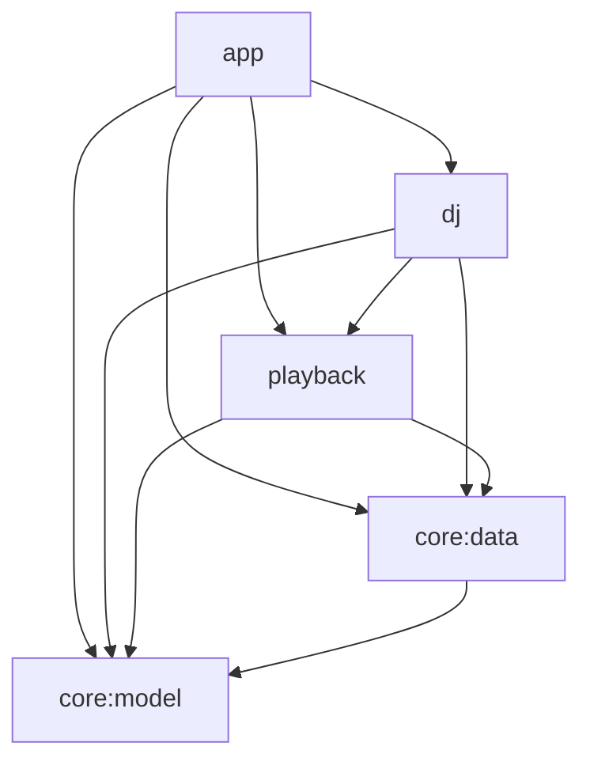

# Any Player Android — Architecture (v2 rewrite)

This document is the design the v2 rewrite is built from. The legacy app's behaviour was
captured per domain before the rewrite (UI, playback, providers/auth, storage/sync, AI DJ);
this design keeps every user-visible feature and every persisted contract, and removes the
structural and performance problems listed in §10.

## 1. Goals and non-goals

Goals
- Same features: Spotify (Connect remote control), Jellyfin and Plex (local ExoPlayer
  streaming), mixed queues, shuffle/repeat, custom STANDARD/UNION playlists with "distinct"
  playback, search, sync server (snapshot/push/WebSocket), state export/import, config-file
  import, AI DJ breaks (remote + on-device LLM/TTS), MediaSession/Android Auto, notification.
- Existing installs upgrade in place: Room `any_player.db` v2, EncryptedSharedPreferences
  `provider_connections`, `spotify_auth_session`, `sync_preferences`, `playback_state`,
  DJ files under `filesDir`, export-file formats, deep link `anyplayer://spotify-callback`.
- No main-thread disk/crypto/network; no always-on polling loops; per-screen state; position
  updates never recompose anything but the position widgets.

Non-goals
- New product features beyond what the bug fixes require (e.g. a richer Android Auto tree).
- Changing server protocols (sync server, DJ endpoints, provider APIs).

## 2. Key decisions

| # | Decision | Why |
|---|---|---|
| D1 | Gradle multi-module: `:core:model` (pure Kotlin/JVM), `:core:data`, `:playback`, `:dj`, `:app` | Enforced layering, parallel compilation, JVM-only unit tests for the core logic |
| D2 | Drop the Rust FFI (`any_player_ffi_android`). Jellyfin, Plex, Spotify catalog clients and the volume-normalization formula are implemented in Kotlin | Rust was used as a blocking per-call HTTP client (new reqwest client per call, whole playlist re-fetched per page → quadratic), Jellyfin/Plex could not connect without the `.so`, and it forced a sibling-repo NDK build. Normalization is 10 lines of math. The desktop app keeps using the shared Rust core |
| D3 | One app-owned queue model for every source mix (no "local/spotify/mixed" modes) | Legacy had three engines with divergent shuffle/repeat/previous semantics and a shared mutable bag |
| D4 | Backends play **runs**: maximal consecutive play-order slices that belong to one backend | Keeps native gapless ExoPlayer playback and native Spotify auto-advance while the app owns order |
| D5 | Queue entries get a stable unique `uid` | Duplicate track ids broke LazyColumn keys, "play from queue", DJ index heuristics |
| D6 | State split into `QueueState` (changes on edits/track changes) and `PlayerState` (changes on transitions) with a **position anchor**; nobody polls for position | Legacy rewrote one giant status every 500 ms on Main and recomposed the whole app |
| D7 | MediaSession player is a `SimpleBasePlayer` derived from engine state; Media3's `DefaultMediaNotificationProvider` owns the notification | Legacy ForwardingPlayer hid ExoPlayer's listeners and re-synthesised events from a polled flow |
| D8 | Queue persisted in Room (`queue_entries`), small playback state in plain SharedPreferences, written on change (debounced) | Legacy re-encoded and AES-encrypted the whole queue every ~3 s |
| D9 | Encrypted stores stay EncryptedSharedPreferences (same files/keys) but are opened lazily on IO and cached in memory as `StateFlow` | Zero migration risk; removes Keystore/Tink init and decrypts from the main thread |
| D10 | Provider caches become normalized Room tables (`cached_playlists`, `cached_tracks`); `app_cache_entries` blobs are dropped in migration 2→3 | Blob cache silently refused >500 KB and decoded whole blobs per access |
| D11 | AI DJ schedule is a pure reducer driven by engine cursor events; breaks are a first-class engine plan item | Removes 500 ms polling, 7 hand-wired advance hooks and ~12 `isPlayingInterstitial` branches |
| D12 | Navigation Compose, one ViewModel per screen, immutable UI models, stable keys (`uid`/original index) | Legacy had one 907-line ViewModel and a 57-field UiState passed to every screen |
| D13 | Restore never starts audible Spotify playback; queue restores paused, Spotify starts on first play with `position_ms` | Legacy hijacked the user's active Connect device on every cold start |

## 3. Modules and dependency rules



| Module | Type | Package root | Contents |
|---|---|---|---|
| `:core:model` | Kotlin/JVM library | `com.anyplayer.android.core.model` | Serializable domain models (wire-compatible), `QueueState` + pure queue ops, run planning, dedupe, volume normalization, DJ break schedule reducer, JSON instance factory |
| `:core:data` | Android library | `com.anyplayer.android.data` | Room DB + DAOs, secure/plain stores, OkHttp + suspend helpers, Spotify/Jellyfin/Plex clients, auth, catalog repository, playlists repository, sync engine, state transfer, startup coordinator |
| `:playback` | Android library | `com.anyplayer.android.playback` | `PlaybackEngine`, backends (Exo, Spotify Connect), audio cache, queue persistence, MediaLibraryService + session player |
| `:dj` | Android library | `com.anyplayer.android.dj` | DJ coordinator, generators (remote/on-device), LLM runtime, sherpa TTS + voice processor, artifact downloads, passage repository |
| `:app` | Android application | `com.anyplayer.android` | Application, MainActivity, navigation, screens, ViewModels, Hilt wiring of app-level bindings |

Rules: `:core:model` has no Android imports. UI never touches DAOs, OkHttp or ExoPlayer.
Feature modules expose interfaces + `StateFlow`s; `MutableStateFlow` is never public.

## 4. Domain model (`:core:model`)

Wire-compatible with legacy JSON (Room converters, sync, export) — names/serial names unchanged:

```kotlin
@Serializable enum class SourceType { @SerialName("spotify") SPOTIFY, @SerialName("jellyfin") JELLYFIN,
  @SerialName("plex") PLEX, @SerialName("custom") CUSTOM, @SerialName("all") ALL }
@Serializable enum class PlaylistType { @SerialName("standard") STANDARD, @SerialName("union") UNION }
@Serializable enum class RepeatMode { @SerialName("off") OFF, @SerialName("one") ONE, @SerialName("all") ALL }
@Serializable enum class PlaybackStateType { idle, playing, paused, buffering, error } // serial names lowercase
@Serializable data class Track(id, title, artist, album?=null, durationMs?=null, source, url?=null,
  imageUrl?=null, bitrateKbps?=null, sampleRateHz?=null, enriched?=null, isDjFiller=false)
@Serializable data class Playlist(id, name, owner, trackCount, source, imageUrl?=null, tracks?=null, description?=null)
@Serializable data class CustomPlaylist(id, name, description?, imageUrl?, createdAt, updatedAt, trackCount, playlistType, isDistinct=false)
@Serializable data class PlaylistTrack(id, playlistId, trackSource, trackId, position, addedAt, title, artist, album?, durationMs?, imageUrl?, url?)
@Serializable data class UnionPlaylistSource(id, unionPlaylistId, sourceType, sourcePlaylistId, position, addedAt)
@Serializable data class PlaybackStatus(...) // kept only for sync/export wire format (legacy shape)
```
`AppJson`: `Json { ignoreUnknownKeys = true; explicitNulls = false }` (encodeDefaults false) —
identical to legacy so export integrity hashes reproduce byte-for-byte.

### 4.1 Queue model

```kotlin
data class QueueEntry(val uid: Long, val track: Track)

data class QueueState(
  val entries: List<QueueEntry> = emptyList(),   // insertion order ("queue")
  val order: List<Int> = emptyList(),            // indices into entries, play order
  val cursor: Int = -1,                          // position in `order`; -1 = nothing current
  val shuffle: Boolean = false,
  val repeat: RepeatMode = RepeatMode.OFF,
  val playNextOffset: Int = 0,                   // stacking for "play next"
  val version: Long = 0,                         // bumps on any change
  val nextUid: Long = 1,
) {
  val current: QueueEntry?            // entries[order[cursor]]
  fun entryAt(orderPos: Int): QueueEntry
  fun upcoming(): List<QueueEntry>    // order after cursor
  fun history(): List<QueueEntry>     // order before cursor
}

object QueueOps {  // pure; Random injected
  fun replace(s, tracks, startIndex, random): QueueState     // startIndex into tracks; shuffle → current first, rest shuffled
  fun playNext(s, track): QueueState                          // insert after cursor + playNextOffset; offset++ ; empty queue → single entry cursor 0
  fun advance(s, wrap: Boolean): QueueState?                  // cursor+1; repeat ALL wraps; null at end
  fun back(s): QueueState?                                    // cursor-1, null at start
  fun jumpToEntry(s, entryIndex): QueueState                  // cursor = order.indexOf(entryIndex)
  fun jumpToUid(s, uid): QueueState
  fun setShuffle(s, on, random): QueueState                   // on: current stays at cursor, rest shuffled; off: order = identity, cursor = current's entry index
  fun setRepeat(s, mode): QueueState
  fun remove(s, uid): QueueState
}
```
Rules (unified; legacy per-mode divergences resolved):
- `playNextOffset` resets to 0 on every cursor move and on `replace` (legacy bug B4).
- Repeat ALL wraps for manual next and auto-advance alike. Repeat ONE is handed to the backend.
- Previous: if position > 3000 ms → seek 0; else `back`; at start → seek 0.
- Shuffle start: `replace(..., startIndex=0)` with shuffle on and >1 track picks a random start
  (legacy rule; no longer excludes Spotify tracks because every source mix uses the same model).

### 4.2 Run planning

```kotlin
enum class BackendKind { EXO, SPOTIFY, UNPLAYABLE }
fun backendFor(track: Track): BackendKind  // SPOTIFY source → SPOTIFY; http/https/file/content/android.resource url → EXO; else UNPLAYABLE

sealed interface PlanItem { data class Song(val entry: QueueEntry, val orderPos: Int) : PlanItem
                            data class Break(val breakId: String, val audioUri: String) : PlanItem }

data class Run(val kind: BackendKind, val items: List<PlanItem>)   // Break items only in EXO runs
fun planRun(state: QueueState, fromOrderPos: Int, pendingBreak: PendingBreak?, maxItems: Int = 50): Run
```
- A run starts at `fromOrderPos` and extends while the next item has the same backend kind,
  without wrapping, up to `maxItems`.
- `PendingBreak(beforeUid, breakId, audioUri)`: in an EXO run the break is spliced as an item
  immediately before `beforeUid`; a SPOTIFY run stops before `beforeUid`, and the break is
  played as a single-item EXO run at the boundary.
- UNPLAYABLE entries are skipped (engine advances past them, error message surfaced once).

### 4.3 Other pure logic
- `Dedupe` (legacy `DistinctPlaylistUtils`; key `trim().lowercase(ROOT)` of title|artist;
  must pass `dedup_spec.json` fixture).
- `VolumeNormalization.effective(volume, source, enabled)` — port of Rust
  `effective_output_volume` with target 85: Spotify `((v*85+50)/100)`, others `round(v*factor)`
  where `factor = clamp((0.04+0.85*0.18)/0.22, 0.1, 1.0)`; disabled → v.
- `BreakSchedule` reducer (§8.1).
- `normalizePlaylistId(source, id)`, `normalizeSpotifyTrackId`, `trackIdsMatch`.

## 5. Data layer (`:core:data`)

### 5.1 Room `any_player.db`
- Keep v2 entities **identical** (`custom_playlists`, `playlist_tracks`, `union_playlist_sources`,
  `provider_playlist_preferences`; enum columns stored as UPPERCASE `.name`; ISO text timestamps;
  `MIGRATION_1_2` kept; custom playlist upsert = INSERT OR IGNORE + UPDATE, never REPLACE).
- Version 3 adds, via `MIGRATION_2_3`:
  - `queue_entries(position INTEGER PK, uid INTEGER NOT NULL, trackJson TEXT NOT NULL)` +
    `queue_order(position INTEGER PK, entryIndex INTEGER NOT NULL)`.
  - `cached_playlists(source TEXT, id TEXT, name, owner, trackCount INTEGER, imageUrl, description,
    position INTEGER, updatedAtMs INTEGER, PRIMARY KEY(source,id))`.
  - `cached_tracks(ownerKey TEXT, position INTEGER, trackJson TEXT, PRIMARY KEY(ownerKey, position))`
    where ownerKey = `p:<source>:<playlistId>` (provider) or `u:<unionId>` (union materialization),
    and `cached_track_owners(ownerKey PK, updatedAtMs, trackCount)`.
  - Drops `app_cache_entries` (cache only) and `column_preferences` (no UI; export keeps the
    `columnPreferences` field in the model so old files re-encode identically).
- Schemas exported to `core/data/schemas`; legacy `1.json`/`2.json` copied there.
- Mutations are single `@Transaction` DAO methods (append track = insert at `COUNT(*)` +
  `trackCount+1`), serialized per playlist.

### 5.2 Stores
| Store | Backing | Notes |
|---|---|---|
| `SecurePrefs` | EncryptedSharedPreferences factory, shared MasterKey (AES256_GCM, default alias), keys AES256_SIV / values AES256_GCM | opened lazily on `Dispatchers.IO`, one instance per file |
| `ConnectionStore` | `provider_connections`, keys `SPOTIFY`/`JELLYFIN`/`PLEX`, value `StoredConnection` JSON | `StateFlow<Map<SourceType, StoredConnection>>`; new optional field `jellyfinUserId` (falls back to legacy `refreshToken` for JELLYFIN) |
| `SpotifyAuthSessionStore` | `spotify_auth_session` keys `state`,`codeVerifier`,`clientId`,`redirectUri` | |
| `SyncSettingsStore` | `sync_preferences`: `sync_preferences_json`, `sync_client_id` | `StateFlow<SyncPreferences>`; writes only on explicit save |
| `DjSettingsStore` | `sync_preferences`: `selected_dj_voice_id`, `selected_dj_model_id`, `dj_remote_generation` (default true), `dj_voice_level` (default 1.0) | same file, separate class |
| `PlayerSettingsStore` | plain SharedPreferences `player_settings` | shuffle, repeat, volume, cursor, positionMs, normalization flags, aiDjEnabled, showDjEntriesInQueue |
| `LegacyPlaybackStateMigrator` | reads ESP `playback_state` key `status` once → Room queue + `player_settings`, then removes key | |

All store reads happen once per process on IO; consumers observe `StateFlow`s.

### 5.3 Networking
- One `OkHttpClient` (connect 15 s, read 30 s, ping 30 s for WS); `suspend fun Call.await()`
  via `enqueue` with cancellation.
- `retrying { }` coroutine helper: 429 (any method) and 5xx (GET/HEAD) → `Retry-After`
  seconds (≤60) else 0.5·2ⁿ s (≤10 s), max 5 retries, `delay` not `Thread.sleep`.
- `SpotifyTokenProvider`: single-flight refresh (Mutex), refresh at `expiresAt-5min`, used by
  every Spotify call (catalog, search, player). 401 → one forced refresh + retry.

### 5.4 Providers
```kotlin
interface ProviderClient {
  val source: SourceType
  suspend fun validate(conn: StoredConnection): ValidationResult
  suspend fun playlists(conn: StoredConnection): List<Playlist>                    // all pages
  suspend fun playlistTracks(conn: StoredConnection, playlistId: String): List<Track> // all pages, one pass
  suspend fun search(conn: StoredConnection, query: String, type: SearchType, limit: Int): SearchResult // only the requested type
}
```
Implementations follow the legacy Rust contracts exactly (endpoints, headers, field mapping,
stream URL formats):
- Jellyfin: `X-Emby-Token` + `X-Emby-Authorization: MediaBrowser ...`; user resolved once at
  connect (`/Users`, matching stored id else first) and persisted as `jellyfinUserId`;
  stream `{base}/Audio/{id}/universal?UserId=..&Container=..&AudioCodec=..`; page size from
  connection (default 300, clamp 1..1000).
- Plex: `X-Plex-Token` query param, `Accept: application/json`; no per-request TCP probe;
  stream `{base}{Media[0].Part[0].key}?X-Plex-Token=..`.
- Spotify: Web API v1; playlists via `me/playlists` all pages; tracks via
  `playlists/{id}/tracks?market=from_token` pages of 100; search single page of 50 per type.
- `ProviderRegistry` maps `SourceType → ProviderClient`.

`CatalogRepository`
- `playlists: Flow<List<Playlist>>` from `cached_playlists` (instant on startup).
- `refreshPlaylists(sources = connected)`: per provider in parallel; replaces that provider's
  rows; failures reported per provider, cache kept.
- `tracks(source, id, forceRefresh=false)`: cache-first; refresh if forced, missing, or older
  than 6 h (background revalidate when stale-but-present). Writes `cached_tracks` in one transaction.
- `refreshAll(onProgress)`: playlists then tracks with Semaphore(4); one playlist failing does
  not abort the others; progress strings kept from legacy.
- `search(query, source, type)`: blank → empty; only requested type; providers in parallel;
  order Jellyfin, Plex, Spotify.

`AuthRepository`
- `connections: StateFlow<Map<SourceType, ProviderConnectionProfile>>`.
- `connectJellyfin/connectPlex(url, token, pageSize)`, `beginSpotifyAuth()`, `completeSpotifyAuth(uri)`,
  `disconnect(source)`, `updatePageSize`. PKCE flow, error strings and ordering identical to legacy;
  scopes = legacy effective scope set (no `streaming`).
- Restore at startup: no network for Jellyfin/Plex; Spotify refreshes only if token expiring. A
  network failure never marks a provider disconnected; auth failures (401) do.

### 5.5 Playlists
`PlaylistRepository` (custom playlists) — legacy `CustomPlaylistEngine` semantics, minus the
playback dependency: it returns track lists; callers hand them to the engine.
- create (blank → "Untitled Playlist"), rename, delete (cascade + union cache), addTrack,
  removeTrackAt, reorder, union sources add/replace/reorder, `materializeUnion(id, force)`
  (sources fetched in parallel with order preserved, nested UNION sources resolved one level,
  `(source,id)` identity dedupe, cached under `u:<id>`, `trackCount` updated),
  `tracksForPlayback(id)` (applies title|artist dedupe when distinct), `providerDistinct` prefs.

Implementation: `RoomPlaylistRepository` uses transactional `CustomPlaylistDao` operations and a
separate `UnionCacheDao`. `PlaylistSourceEditor` exposes incremental add/remove/reorder edits
without changing the shared repository contract. Source edits commit sources, normalized cache,
and count/timestamp together after bounded parallel fetches; a CUSTOM union source expands one
level only. UI observation never starts provider requests.

### 5.6 Sync
`SyncEngine` (`@Singleton`, application scope) — wire protocol unchanged
(`GET /v1/snapshot[?since_version]`, `PUT /v1/state/{app-state|playlists|settings|provider-configuration}`
with `{client_id,data}`, WS `/v1/ws` events), status strings unchanged.
- Settings edits are drafts in the UI; persisted + (re)connected only on **Connect/Save**.
- Realtime push on discrete changes (queue version, current entry, play state, seek, volume,
  shuffle, repeat), throttled to ≥2 s and ≤1 per 15 s when only position drifts; never per tick.
- WS reconnect with exponential backoff (1 s → 60 s, jitter), paused while no network.
- Startup pull runs after the UI is up and does **not** re-run startup; a provider-config change
  re-validates only that provider.
- Legacy fixes: `lastSyncVersion` advanced on every applied snapshot.

### 5.7 State transfer / config import
- Formats byte-compatible (models ported; same `AppJson`; PBKDF2-HMAC-SHA256 150 000 iters,
  16-byte salt, AES-256-GCM 12-byte nonce, Base64 standard; integrity SHA-256 of canonical
  re-encoding; encrypted-file detection rules).
- One `PlaylistImporter(policy, dryRun)` shared by state import, config import and sync pull.
- Fixes: connection import merges into existing connections and never clears tokens; dry run
  writes nothing; MERGE_KEEP_LOCAL remaps child ids deterministically; empty union allowed.
- Streams are read/written on IO inside a read transaction.

Implementation: `PlaylistImporter` is shared by `LegacyStateTransfer` and `LegacyConfigFiles`;
each import replaces children only for the imported destination playlists, avoiding primary-key
and position conflicts with retained local playlists. Config natural-key UUIDs remain unchanged
for first occurrences; repeated tracks/sources use a deterministic occurrence component so a
round trip cannot collapse intentional duplicates. State integrity uses the legacy declaration
order/default omission rules; the independent fixture ports the legacy transfer test's seed.
Config sync exports use `Json { ignoreUnknownKeys = true }`, including its default
`explicitNulls = true` and `encodeDefaults = false` behavior.

### 5.8 Startup
`AppStartup` (application scope, started from `Application.onCreate` on a background dispatcher):
1. Migrate legacy playback state (once).
2. Restore engine queue (paused) — UI can render immediately from Room flows.
3. Restore provider sessions in parallel (§5.4).
4. Refresh provider playlist list in background (stale-while-revalidate).
5. Sync startup pull (if configured), then realtime sync.
Exposes `StartupState(warnings, inProgress)`; the UI banner shows warnings with Retry.

## 6. Playback (`:playback`)

### 6.1 Engine
```kotlin
interface PlaybackEngine {
  val queue: StateFlow<QueueState>
  val player: StateFlow<PlayerState>
  fun positionMs(): Long                          // extrapolated from anchor
  fun setQueue(tracks: List<Track>, startIndex: Int = 0, autoPlay: Boolean = true)
  fun playNext(track: Track)
  fun playEntry(uid: Long)
  fun play(); fun pause(); fun togglePlayPause()
  fun next(); fun previous()
  fun seekTo(ms: Long)
  fun setVolume(percent: Int)
  fun setShuffle(on: Boolean); fun setRepeat(mode: RepeatMode)
  fun setNormalization(enabled: Boolean)
  // DJ host
  val events: SharedFlow<EngineEvent>             // TrackStarted(uid, orderPos), BreakStarted(id), BreakEnded(id), QueueReplaced
  fun setPendingBreak(b: PendingBreak?)
}

data class PlayerState(
  val status: PlaybackStateType, val currentUid: Long?, val durationMs: Long,
  val anchorPositionMs: Long, val anchorElapsedRealtimeMs: Long, val isAdvancing: Boolean,
  val volume: Int, val normalization: Boolean, val error: String?, val activeBreakId: String?,
)
```
- Confined to the main thread (ExoPlayer requirement). Each command applies the new
  `QueueState` synchronously (UI responds instantly) and then reconciles the backend in a
  single `reconcileJob` that is cancelled by the next command (latest wins).
- Reconcile: `planRun(queue, cursor, pendingBreak)`; if the active backend already plays a run
  whose current item matches, it only updates upcoming items (`updateUpcoming`), otherwise
  `load(run, start, position, playWhenReady)` on the right backend and stops the other.
- Backend events: `ItemStarted(i)` → set cursor to that item's orderPos (or break active),
  `RunEnded` → advance past the run (`QueueOps.advance` with repeat ALL wrap) and reconcile,
  `Error` → retry policy (prepare ≤3 per item at ≥1.5 s spacing, then skip).
- Persistence: queue → Room on `queue.version` change (debounced 500 ms, IO); cursor/position
  → `player_settings` on pause, track change, seek, and every 15 s while playing.
- Restore: load queue + cursor paused; position applied lazily on the first `play` (Exo:
  `seekTo`; Spotify: `position_ms` in the start request). No network at restore.

### 6.2 Backends
```kotlin
interface PlaybackBackend {
  val kind: BackendKind
  val events: Flow<BackendEvent>    // ItemStarted(indexInRun), PlayingChanged(isPlaying, buffering), RunEnded, Error(msg)
  suspend fun load(run: Run, startIndex: Int, positionMs: Long, playWhenReady: Boolean)
  suspend fun updateUpcoming(run: Run, currentIndex: Int)
  suspend fun play(); suspend fun pause(); suspend fun seekTo(ms: Long)
  suspend fun setVolume(effectivePercent: Int); suspend fun setRepeatOne(on: Boolean)
  suspend fun stop()
  fun positionMs(): Long; fun durationMs(): Long
}
```
- `ExoBackend`: one ExoPlayer (audio attributes + focus + becoming-noisy handled by ExoPlayer),
  `CacheDataSource` over OkHttp data source; media item ids `"${uid}"` for songs,
  `dj-filler:<breakId>` for breaks; `customCacheKey = "${SOURCE}:${trackId}"` and prefetch
  uses the same key (fixes B1); prefetch only the next track's first 2 MB. Jellyfin auth headers
  injected per request from in-memory connection snapshot (scheme+authority match).
  `updateUpcoming` edits the timeline after the current item — no rebuffer.
- `SpotifyBackend`: `PUT me/player/play` with the run's URIs + offset (+`position_ms`), device
  resolution and Spotify-app launch fallback as legacy (strings unchanged). Poller is active only
  while the Spotify backend holds a run: 1 s when <5 s remain, 2 s while playing, 5 s while
  paused; stopped otherwise. Raw polled progress drives stall detection (fixes B2). Track id →
  run index mapping emits `ItemStarted`; stopped near end of the last run item or track moved
  outside the run → `RunEnded`; manual-pause grace 5 s; recovery: ≤3 restarts at the last
  position with 2.5/4 s cooldowns, then ERROR "Couldn't get Spotify playback back (…). Press
  play to try again.". No server-side shuffle (order owned by the app); repeat ONE → `track`, else `off`.
- Volume: Exo gets `effective(volume, source)`/100; Spotify gets `effective(volume, SPOTIFY)` via
  `PUT me/player/volume` (debounced 300 ms).

### 6.3 Session / service
- `AnyPlayerMediaLibraryService` (FQN unchanged:
  `com.anyplayer.android.feature.playback.service.AnyPlayerMediaLibraryService`, same intent
  filters, `foregroundServiceType=mediaPlayback`).
- `SessionPlayer : SimpleBasePlayer` built from `queue`/`player` flows (invalidated only when
  they emit): playlist = play-order window (cursor−100 … cursor+400) mapped to
  `MediaItemData(uid)`, position via extrapolating `PositionSupplier`, DJ override metadata
  ("AnyPlayer DJ") while a break plays. Commands: play/pause, next/previous, seek, seek to item,
  shuffle, repeat. Media3 notification provider handles the notification + artwork.
- Browse tree: root id `"root"` → current play-order queue as playable items (mediaId = uid
  string; legacy track-id lookups still accepted in `onGetItem`/`onSetMediaItems`).
- Projection controller connect/disconnect behaviour and 1.5 s auto-pause on last disconnect kept;
  noisy-audio pause for Spotify playback handled by the service receiver.

## 7. App/UI (`:app`)

Navigation (bottom bar: Now Playing · Playlists · Search · Settings; mini-player above the bar
on every tab except Now Playing):
`now_playing`, `playlists`, `playlists/provider/{source}/{id}`, `playlists/custom/{id}`,
`search`, `settings` (tabs General · Providers · AI DJ).

| Screen | ViewModel | State sources |
|---|---|---|
| Now Playing | `NowPlayingViewModel` | `engine.queue` → `QueueUi(upcoming, history)` built off-main on version change; `engine.player`; DJ songs-away/status |
| Playlists | `PlaylistsViewModel` | `catalog.playlists`, `playlistRepo.customPlaylists` |
| Provider detail | `ProviderPlaylistViewModel` (SavedStateHandle source/id) | tracks flow, distinct pref, duplicate groups computed off-main on change |
| Custom detail | `CustomPlaylistViewModel` | same + union sources editor |
| Search | `SearchViewModel` | query/source/type in SavedStateHandle; `collectLatest` cancels stale searches; loading/empty/error states |
| Settings | `GeneralSettingsViewModel`, `ProvidersViewModel`, `AiDjViewModel` | stores, sync engine, transfer, DJ |
| Shell | `AppViewModel` | startup warnings, Spotify auth launch/redirect |

Compose rules: screens are stateless `(state, actions)`; ViewModels expose one `StateFlow<ScreenUi>`
collected with `collectAsStateWithLifecycle`; lists are `LazyColumn` with keys `uid` (queue) or
`"$originalIndex"` (playlist/search rows); slider drags keep local state and commit on
`onValueChangeFinished`; position text/slider read `engine.positionMs()` through a
`produceState` ticker that runs only while visible and playing; UI models are `@Immutable`.
Test tags/labels of the legacy androidTests are kept where the control still exists.

## 8. AI DJ (`:dj`)

### 8.1 Schedule reducer (`:core:model`)
```kotlin
data class BreakSchedule(val enabled: Boolean, val songsUntilBreak: Int, val anchorOrderPos: Int,
                         val orderVersion: Long, val failedOnCurrent: Boolean, val targetUid: Long?)
sealed interface ScheduleEvent { Enabled(Boolean); QueueReplaced; CursorMoved(orderPos, orderVersion, uidAtPos…);
  BreakStarted; GenerationFailed; }
fun reduce(s: BreakSchedule, e: ScheduleEvent, queue: QueueState, random: Random): BreakSchedule
```
- Interval random in [3,5]; exactly 3 after a failure/mismatch; forward cursor moves count the
  delta of real songs; backward moves/order changes re-anchor without counting; target =
  entry `songsUntilBreak` songs after the anchor (the break plays **before** `targetUid`).
- `songsAway` for the UI = distance from cursor to target.

### 8.2 Coordinator
`DjCoordinator` (application scope, single-thread dispatcher for state): observes
`engine.queue` (distinct on cursor/version) and `engine.events`; runs the reducer; when the target
changes it cancels the running generation and starts a new one for `targetUid`'s track; on success
saves to `dj_filler/<breakId>.wav` (unique per break; fixes the single-slot race) and calls
`engine.setPendingBreak(PendingBreak(targetUid, breakId, uri))`; on `BreakStarted` records the
passages (async) and schedules the next; on `BreakEnded` deletes the file. Startup sweeps orphan
`dj_filler/*.wav`, `*.part`.

### 8.3 Generation
- `PassageRepository` (`GET /v1/dj-passages`, played receipts `POST /v1/dj-passages/played`,
  30-day exclusion, token budget 2500, state in SharedPreferences `dj_passage_repository` keyed
  `state_<sha256(base\0token)>`, written with `apply()` on IO; flush in background, never blocks
  lookup).
- `RemoteBreakGenerator` (`POST /v1/dj-breaks`, 200 WAV / 204 rejected) → voice processor.
- `OnDeviceBreakGenerator`: `ScriptGenerator` (MediaPipe `.task` / LiteRT-LM `.litertlm`,
  prompts verbatim from legacy, draft+check ×2) on a dedicated low-priority thread; released on
  disable/trim and after 10 min idle; `VoiceSynthesizer` (sherpa-onnx Kokoro/Piper, espeak data
  extracted once keyed by versionCode, `numThreads = min(4, cores/2)`), `VoiceProcessor` DSP
  chain unchanged.
- `ArtifactStore<Descriptor>` shared by models (`/v1/dj-models`) and voices
  (`/v1/dj-voice-models`): catalog, validation, download to `.part` with SHA-256 + size, atomic
  activation marker, delete, listing; progress emitted ≤4 Hz; legacy on-disk layout and markers
  preserved; voice bundle hash verified once after extraction (marker), never on hot paths.

## 9. Threading summary

| Work | Where |
|---|---|
| Engine, ExoPlayer, session player | Main (light, event-driven) |
| Room, prefs, file I/O, JSON of large payloads | `Dispatchers.IO` |
| Network | OkHttp async + suspend |
| Dedupe / UI model building for large lists | `Dispatchers.Default` with `flowOn` |
| LLM, TTS, DSP | dedicated single-thread executors (background priority) |

## 10. Legacy problems addressed (traceability)

| Legacy problem | Addressed by |
|---|---|
| 500 ms Main polling loop; whole UI recomposed twice a second | D6, §6.1, §7 |
| 907-line MainViewModel; 57-field UiState | D12 |
| Three playback engines; divergent semantics; shared mutable bag | D3, D4, §4.1 |
| Duplicate-id LazyColumn crash; wrong occurrence played | D5 |
| Main-thread EncryptedSharedPreferences/crypto/JSON | D9, §5.2 |
| Whole queue encrypted every 3 s | D8 |
| Quadratic Rust paging; 100-playlist cap; Jellyfin user bug; no Spotify token refresh for catalog | D2, §5.3, §5.4 |
| Blob caches capped at 500 KB | D10 |
| Prefetch cache-key mismatch | §6.2 |
| Spotify restore hijacks active device | D13 |
| Sync: WS restart per keystroke; queue pushed every 5 s; startup run twice | §5.6, §5.8 |
| Export/import data-loss bugs | §5.7 |
| DJ: voice bundle SHA on main thread; single-slot race; progress floods; models never released | §8 |
| Search races; no loading/error states | §7 |

## 11. Verification plan
- JVM unit tests (`:core:model`): queue ops, run planning, schedule reducer, dedupe fixture,
  normalization parity with the Rust formula.
- `:core:data` tests: provider JSON parsing + paging against MockWebServer, transfer
  round-trip/integrity with legacy fixture, PKCE/auth error ordering.
- Instrumented: Room migration 1→2→3 with the legacy schemas, opening a real legacy v2 database.
- Emulator smoke: in-place upgrade over the legacy build (playlists + sync target survive),
  play a Jellyfin-compatible mock server stream end to end (queue, next/prev, shuffle,
  notification, process restore), startup and frame metrics compared with the legacy baseline
  (cold start 1606 ms, 19% janky frames, PSS 147 MB on `test_pixel_35`).

## 12. Design-review amendments (authoritative — supersede earlier sections where they conflict)

Accepted after an independent review (Media3 1.5.1 behaviour verified against the jars).

### 12.1 Queue and planning (§4)
- `QueueState.version` is split: `contentVersion` bumps only when `entries`/`order` change;
  cursor moves do not bump it. Persistence, `QueueUi` rebuilds and sync queue pushes key on
  `contentVersion`; cursor changes are handled separately.
- `QueueOps.replace(s, tracks, startIndex, randomStart, random)`: a random start happens only when
  `randomStart` is true (user-initiated play, `startIndex == 0`, shuffle on, >1 track). Restore and
  sync never randomize.
- `playNext` inserts into **both** `entries` (after the current entry + offset) and `order`
  (after cursor + offset). Only `jumpToUid` is kept (no `jumpToEntry`/`remove`).
- UNPLAYABLE entries are skipped **inside** a run; runs are EXO or SPOTIFY only. Spotify tracks
  whose normalized id is not `[A-Za-z0-9]{22}` are UNPLAYABLE.
- The engine reconciles again on every `ItemStarted`, so EXO runs slide forward (append upcoming
  items, trim history to ≤3 items) — no rebuild gap every 50 tracks.

### 12.2 Engine (§6.1) — level-triggered reconciler
- Every backend `load` carries a monotonically increasing `loadId`; every `BackendEvent` carries
  its `loadId` and identifies items by `uid`/`breakId` (never by index). Events from stale loads
  are dropped; the engine resolves order positions from the current `QueueState`.
- No cancellation of in-flight backend commands. The engine holds
  `desired: Desired(plan, playWhenReady, seekRequest)`; one reconcile loop applies the latest
  desired state; each backend has a serialized command channel and reports `applied` state;
  reconcile compares desired vs applied. Stale results are discarded, not cancelled mid-request.
- Pauses originating from the player (audio-focus loss, becoming noisy) or an external Spotify
  pause are **adopted into intent**, never overridden.
- Switching backends: pause/stop the old one before starting the new one.
- Public engine methods may be called from any thread; they hop to `Dispatchers.Main.immediate`.
  ExoPlayer is created lazily on the first EXO load.
- `PlaybackGate` (legacy "playback disabled" guard): when the current track's provider is not
  connected the engine blocks play/toggle (from UI, session, notification, sync), auto-pauses once
  per track and exposes `PlayerState.disabledReason` ("Playback disabled: … Next/Previous still
  works."). `isSourceConnected` fails open as in legacy.
- `PlayerState` gets an `origin` on mutations exposed via `engine.changes: SharedFlow<Change>`
  (`USER | SYNC | RESTORE`) so sync never pushes SYNC/RESTORE-originated changes.

### 12.3 Spotify backend (§6.2)
- Load is idempotent: if a poll already shows the target track playing within ±3 s, adopt it.
- On every load force `PUT shuffle?state=false` when the polled `shuffle_state` is true, and set
  repeat (`track` for ONE, else `off`).
- `updateUpcoming` semantics: if only the run end moved earlier (break inserted / next item is
  EXO), set `stopAfterUid` and pause at the end of that item (end-of-item timer at
  `remaining − 300 ms` + forced poll) then emit `RunEnded`; if the next item within the loaded
  prefix changed (playNext, shuffle), reload with `{uris, offset: current, position_ms}` debounced
  300 ms; edits beyond the loaded window need nothing. Every Spotify→EXO/break boundary uses the
  end-of-item pause (also prevents Spotify Autoplay bleed). Never use `POST me/player/queue`.
- End detection: run index is monotonic during natural playback; a backward mapping is honoured
  only inside the settle window (≤3 s) after an explicit seek/previous/load; polls that don't show
  the expected track are ignored during the settle window; `RunEnded` arms only after
  `is_playing=true` was observed for the current item; match `item.id` or `item.linked_from.id`;
  an unknown id must appear on 2 consecutive polls to count as "outside the run".
- `PlayerState` is re-anchored from polls only on drift > 750 ms, play-state or track change.
- Device launch fallback only while the app is in the foreground; otherwise fail with the legacy
  "No active Spotify Connect device…" message. Pre-resolve the device ~20 s before an EXO→SPOTIFY
  boundary.

### 12.4 Session / service (§6.3)
- `SessionPlayer` reports `STATE_BUFFERING` + `playWhenReady=true` whenever the engine intends to
  play but no backend is producing audio (run boundary, loading), so Media3 keeps the service in
  the foreground. ERROR maps to `STATE_IDLE` + `playerError`; empty queue → `STATE_IDLE`.
- Spotify-only playback intentionally keeps the mediaPlayback foreground service (the poller must
  survive screen-off). `onForegroundServiceStartNotAllowedException` posts a "tap to resume"
  notification. The service is started from `MainActivity.onCreate` and on the first play while in
  the foreground.
- Paged window: playlist window recomputed only when the cursor leaves the middle band or
  `contentVersion` changes; `MediaItemData`/`MediaItem` cached per uid. `handleSeek` dispatches on
  the seek command (NEXT/PREVIOUS → engine.next/previous; SEEK_TO_MEDIA_ITEM → playEntry(uid)).
- A DJ break is exposed as its **own** `MediaItemData(uid = "dj-filler:<id>")` with its own
  duration, inserted before the target song.
- Advertise `COMMAND_SET_MEDIA_ITEM` and `COMMAND_CHANGE_MEDIA_ITEMS`; `handleSetMediaItems`
  resolves uids or legacy track ids (legacy "same id-set → don't reload" rule).
- Implement `onPlaybackResumption` (await restore ≤5 s, return restored queue).
- `DefaultMediaNotificationProvider` configured with channel `any_player_playback`
  ("Any Player Playback"), notification id 1001, small icon `ic_notification`.
- Manifest contracts kept: `<queries>` for `com.spotify.music` and `market` VIEW,
  `networkSecurityConfig`, `allowBackup="false"`, `singleTask`, Auto meta-data + `uses-feature`,
  `versionCode` 2 (legacy is 1). Audio cache stays `cacheDir/audio_cache`, LRU 500 MiB,
  `StandaloneDatabaseProvider`. `ProjectionControllerGuard` is deleted (it was log-only); the
  projection connect/disconnect auto-pause behaviour is kept.

### 12.5 Persistence (§5.1, §5.2, §6.1)
- Room v3 **adds** tables only; `app_cache_entries` and `column_preferences` stay as entities
  (column prefs are written by state import and read by export). A one-shot background
  `LegacyCacheImporter` converts `provider_playlists`, `provider_playlist_tracks_*` and
  `union_playlist_tracks_*` rows into the new cache tables and then deletes those rows (no JSON
  parsing inside `Migration.migrate`).
- Queue tables: `queue_entries(uid INTEGER PK, seq INTEGER, trackJson TEXT)` +
  `queue_meta(id=0 PK, orderUids TEXT, cursorUid INTEGER, contentVersion INTEGER)`. Content is
  written on `contentVersion` change; cursor uid on cursor change; both in Room (cursor never
  points into a different queue). Position/flags stay in `player_settings`.
- Appends use `COALESCE(MAX(position)+1, 0)` (legacy data can have gaps).
- First DB open runs off-main; no destructive fallback.
- `ConnectionStore` writes are single-writer (mutex). Jellyfin user id: legacy installs never
  stored it, so it is resolved lazily on the first Jellyfin call (`/Users`: stored id else first
  user) and persisted as `jellyfinUserId`.
- `LegacyPlaybackStateMigrator`: legacy `currentQueueIndex` is in insertion space; `orderedQueue`
  is mapped to `order` with occurrence-aware matching; the legacy key is removed only after the
  Room commit.

### 12.6 Sync (§5.6)
- Field edits persist on commit (IME done / focus loss, debounced) — DJ features read the persisted
  target/token; the WebSocket restarts only on Connect.
- Push only after a non-empty queue has been observed post-restore; never push SYNC/RESTORE-origin
  changes; keep the 3.5 s post-apply suppression as a backstop; keep "apply startup pull only if
  local playback didn't change during the fetch".
- Push on discrete events only (track/content/state/shuffle/repeat/volume change, pause and seek
  with exact position) — never periodically. WS events fetch `GET /v1/state/app-state` when only
  `app_state` changed, falling back to `/v1/snapshot?since_version`.
- Startup network work (catalog refresh, sync pull) is gated on the UI reaching STARTED
  (`ProcessLifecycleOwner`) or playback starting; restore steps run for every process start.

### 12.7 AI DJ (§8)
- A pending break plays only when the cursor reaches `targetUid` by advance (auto or manual Next)
  from the preceding song; jumps skip it. During a break the cursor stays on the pre-break song;
  `previous()` during a break cancels it and restarts the pre-break song; `next()` skips the break.
- The engine validates `PendingBreak.beforeUid` against `upcoming()`; dropped breaks (target passed,
  queue replaced, disabled) are reported via `EngineEvent.BreakDropped(id)` so the coordinator
  deletes the file.
- Finished audio is kept keyed by track id (+passage chunk ids) so a target flip-back reuses it;
  in-flight generation is cancelled only on disable or queue replace.
- LLM released on disable, `onTrimMemory`, or after N minutes without playback (not per break).
- `DjDiagnostics` in-memory ring buffer (200) backs the "AI DJ Logs" panel ("Enable debug
  logging", Clear, Copy).
- Named legacy migrations: root `dj_models/*.task` without marker; `dj_tts/voice/active-version`
  + `default/` → `default/default`; delete `dj_fact_repository` prefs; sweep `ready.wav`,
  `ready-track-id`, `ready-passages.json`, `ready-fact.json`, `dj_models/**/*.part`, voice
  staging `.tmp`/`.zip.part`.

### 12.8 Misc
- Normalization uses `Float` math exactly as Rust; parity test over 0..100 for each source.
- Keep legacy import remap suffixes (`_import_`/`_cfg_` + `nameUUIDFromBytes`).
- On cached playlist refresh, delete cached tracks of playlists that disappeared upstream in the
  same transaction; `cached_track_owners` holds owner metadata for both provider and union owners.
